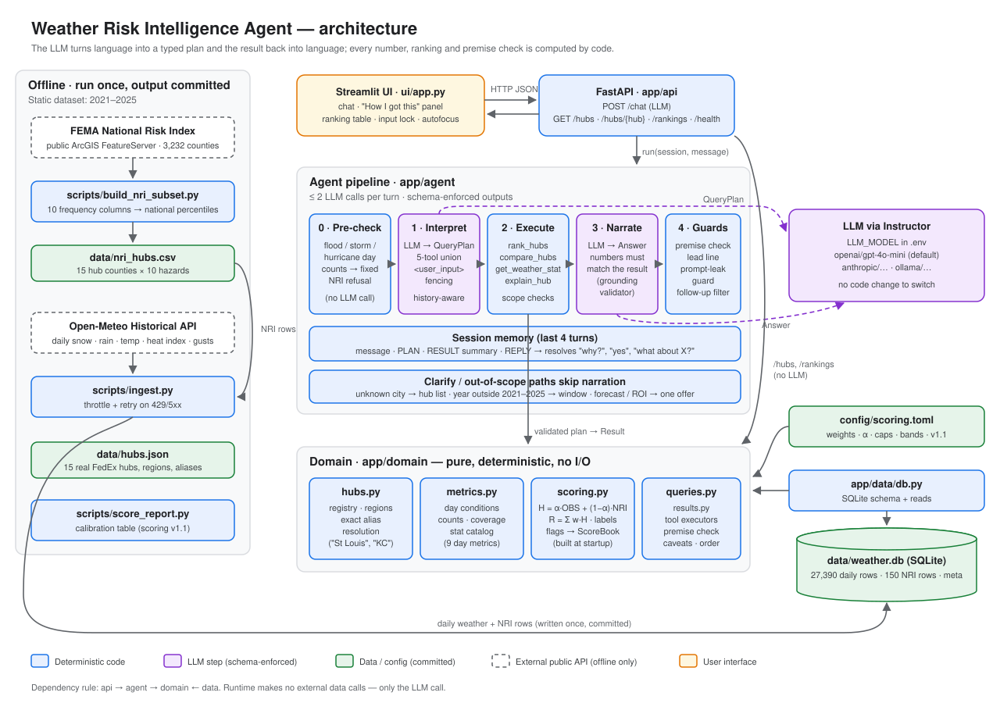
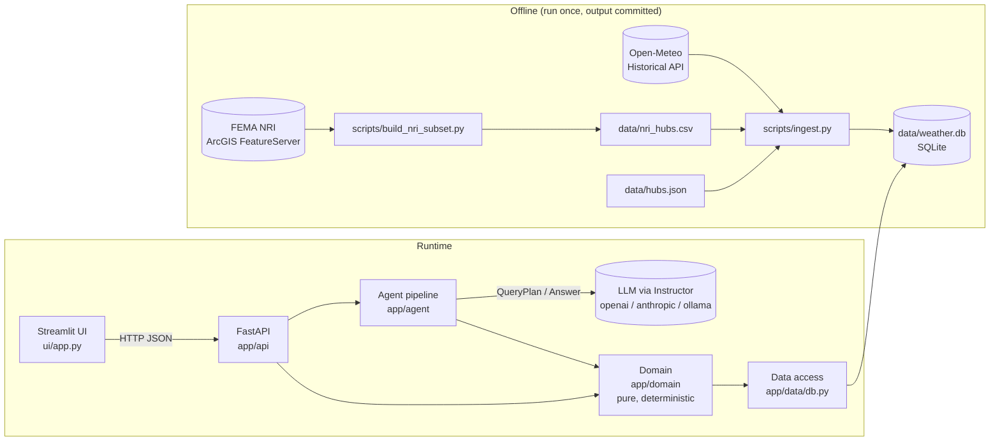
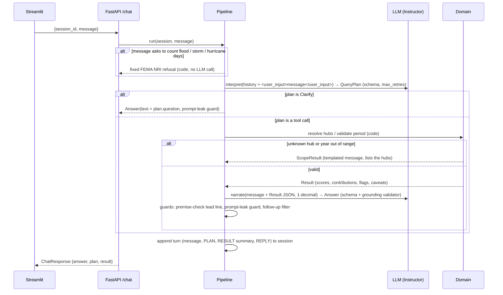

# 03 — Architecture

_status: implemented · 2026-10-23 · scope: core agent (alerts, deployment and voice are deferred)_



## 1. Principles

- **Static dataset.** The data covers 2021–2025 and is fetched once by scripts, then committed: `data/weather.db` and `data/nri_hubs.csv`. Runtime makes no external data calls; the only network call at runtime is to the LLM.
- **Deterministic core, LLM at the edges.** The LLM turns language into a typed plan, code computes the result, and the LLM turns the result back into language.
- **Schemas everywhere.** Pydantic models define every boundary: LLM ↔ code, API ↔ UI, DB ↔ domain.

## 2. Components



| Component | Responsibility | Talks to |
|---|---|---|
| `scripts/build_nri_subset.py` | Query NRI for all counties (only the needed columns), compute national percentiles, write a 15-row CSV | FEMA ArcGIS (offline) |
| `scripts/ingest.py` | Fetch daily weather per hub (throttled, with retry), load NRI CSV, write SQLite | Open-Meteo (offline), SQLite |
| `app/data` | SQLite schema and read queries; returns plain dataclasses | SQLite |
| `app/domain` | Hub registry and name resolution, metrics, scoring, query executors. **No I/O.** | Data passed in |
| `app/agent` | `interpret → execute → narrate` pipeline, LLM client, prompts, session memory | LLM, domain |
| `app/api` | HTTP endpoints, request/response models, app startup (builds the `ScoreBook`) | Agent, domain |
| `ui/app.py` | Chat UI plus a "show the work" panel (plan JSON, result table) | API only |

**Dependency rule:** `api → agent → domain ← data`. The domain imports nothing from the other layers.

## 3. Data flow: one chat turn



- **At most two LLM calls per turn.** Clarifications and scope errors need one; hazard-count questions need none.
- **Follow-ups:** `interpret` sees the last 4 turns. Each turn shows the user message, the PLAN that ran (clarify plans are omitted, because replaying them made the model repeat refusals), a code-built RESULT summary (e.g. "1. Houston, 2. Dallas") and the REPLY the user saw. `interpret` must output a **complete** plan, so execution is stateless.
  - "What about Chicago?" after a Dallas explain query → `ExplainQuery(hub="Chicago")`
  - "Why?" after a ranking → explain the hub ranked 1
  - "yes" → the offer in the previous REPLY
- **Number grounding:** the `Answer` validator receives the `Result` as Instructor validation context. Every number in `text` and `caveats` must match a value in the result (±0.05, or ±0.5 for integers; years 2021–2025 and integers 0–20 always pass). If one doesn't, Instructor retries and feeds the error back to the model. The narrator sees values rounded to 1 decimal, so it never has to round anything itself.
- **Deterministic guards after the LLM** (`app/agent/guards.py`, `pipeline.py`):
  - **False premise:** the answer opens with a premise-check line written by code.
  - **Prompt leaks:** any reply that repeats lines of the instructions is replaced with a refusal.
  - **Follow-ups:** suggestions the tools can't answer (seasons, forecasts, ROI, hazard-day counts, years outside the window) are dropped.
  - **Carried-over premises:** `asserted_level` is dropped unless the current message states a level.

## 4. Agent tools (the `QueryPlan` contract)

The "tools" are deterministic executors. The LLM selects one by emitting a member of a **discriminated union**, so it can't call anything else or pass arguments of the wrong type.

```python
Hazard = Literal["winter", "hurricane", "flood", "heat", "severe_storms"]
Region = Literal["midwest", "south", "west", "northeast"]
Period = Literal["last_year", "full_window"] | int   # any year; the domain scopes out-of-window years

class RankQuery(BaseModel):      tool: Literal["rank_hubs"]
                                 hazard: Hazard | Literal["overall"] = "overall"
                                 region: Region | None = None
                                 hubs: list[str] = []          # raw mentions, resolved in code
                                 top_n: int | None = None      # ≥ 1
                                 order: Literal["highest", "lowest"] = "highest"   # "safest" → lowest
class CompareQuery(BaseModel):   tool: Literal["compare_hubs"]
                                 hubs: list[str]  (min 2)
                                 hazards: list[Hazard] = []    # empty = all + overall
class StatQuery(BaseModel):      tool: Literal["get_weather_stat"]
                                 hub: str
                                 metric: StatMetric            # enum from scoring doc §6
                                 aggregation: Literal["count", "pct_of_days", "per_year_avg"]
                                 period: Period
class ExplainQuery(BaseModel):   tool: Literal["explain_hub"]
                                 hub: str
                                 hazard: Hazard | None = None  # "high-risk for winter" → winter
                                 asserted_level: Literal["low", "medium", "high"] | None   # user's premise
class Clarify(BaseModel):        tool: Literal["clarify"]
                                 question: str  (max 500 chars)
                                 reason: Literal["ambiguous", "out_of_scope", "unsupported", "hazard_count"]

class QueryPlan(BaseModel):
    action: Annotated[RankQuery | CompareQuery | StatQuery | ExplainQuery | Clarify,
                      Field(discriminator="tool")]
    # a bare tool call without the `action` wrapper is wrapped before validation (gpt-4o-mini quirk)
```

Design choices:
- **Hub names are free strings, not an enum.** With an enum, "Tokyo" would be forced onto the nearest valid hub. The code resolves names against `hubs.json` aliases. An unknown name returns a `ScopeResult` that lists the 15 hubs.
- **`period` is symbolic.** The code maps `last_year` to 2025 (the last year in the dataset), so the LLM does no date math.
- **`asserted_level` makes the premise check deterministic.** The result carries `premise_check {asserted, actual, holds, hazard, rank, total}`.
  - **Overall premise:** compared with the composite label.
  - **Hazard premise:** judged by the hub's rank for that hazard across the 15 hubs (top third high, middle medium, bottom third low). "Why is Miami high-risk for winter?" → winter rank 14 of 15 → low → rejected.
- **`order`** lets "lowest / safest" rankings sort ascending. The result carries `order` so the narrator can't call the safest hub "highest".

| Tool | Executor (`app/domain/queries.py`) | Result |
|---|---|---|
| `rank_hubs` | filter by region/hubs → sort by `H_hazard` or `R` (descending, or ascending for `order="lowest"`) → top-n | `RankResult[order, rows: hub, score, label (overall only), top_drivers, hazard_detail, flags]` |
| `compare_hubs` | per-hazard `H`, `OBS`, `NRI` per hub; leader and gap per hazard | `CompareResult` |
| `get_weather_stat` | filter the hub's daily rows to the period → count / pct / per-year | `StatResult[value, condition, matched_days, days_in_period, days_with_data, source]` |
| `explain_hub` | composite breakdown: contributions `c_h`, `OBS` metrics, NRI percentiles, rank, premise check (overall or per hazard) | `ExplainResult[hub, focus_hazard, premise_check]` |
| `clarify` | none | the question is returned as the answer. It ends with one concrete yes/no offer, so a following "yes" can be answered |

Every `Result` carries `caveats: list[str]` and per-hub `flags`, as defined in the scoring doc §5.

### Narration output

```python
class Answer(BaseModel):
    text: str                       # markdown, ≤ ~200 words
    caveats: list[str]              # chosen from Result.caveats, may be rephrased
    suggested_followups: list[str]  # ≤ 3
```

## 5. Database (SQLite, `data/weather.db`, committed)

```sql
CREATE TABLE daily_weather (
    hub_id            TEXT NOT NULL,
    date              TEXT NOT NULL,      -- ISO yyyy-mm-dd, hub local time
    snowfall_cm       REAL,
    precip_mm         REAL,
    tmax_c            REAL,
    tmin_c            REAL,
    apparent_tmax_c   REAL,
    gust_max_kmh      REAL,
    PRIMARY KEY (hub_id, date)
);                                         -- 15 hubs × 1826 days ≈ 27k rows

CREATE TABLE nri_hazard (
    hub_id        TEXT NOT NULL,
    county_fips   TEXT NOT NULL,
    hazard_code   TEXT NOT NULL,           -- WNTW, ISTM, CWAV, HRCN, IFLD, CFLD, HWAV, TRND, HAIL, SWND
    afreq         REAL,                    -- annualized frequency
    national_pctl REAL NOT NULL,           -- 0–100, strict-below percentile over 3,232 counties
    PRIMARY KEY (hub_id, hazard_code)
);

CREATE TABLE dataset_meta (
    key   TEXT PRIMARY KEY,                -- window_start, window_end, open_meteo_url, nri_url, ingested_at
    value TEXT NOT NULL
);
```

What is **not** stored, and why:
- **Hubs:** `data/hubs.json` is the single source of truth. It's configuration, reviewed in git.
- **Scores:** computed in memory at API startup into a `ScoreBook` (under 1 s for 15 hubs). Edit `config/scoring.toml`, restart, and the new scores take effect. Score snapshots will be added when the alert bonus is picked up.
- **Chat sessions:** an in-memory `dict[session_id, list[Turn]]`, lost on restart, which is fine for a local demo. Move to SQLite if persistence is needed.

## 6. API (FastAPI, `/docs` gives the OpenAPI UI)

| Method | Path | Body / query | Response | LLM? |
|---|---|---|---|---|
| POST | `/chat` | `{session_id?: str, message: str}` | `ChatResponse {session_id, answer: Answer, plan: QueryPlan, result: Result \| null}` | yes |
| GET | `/hubs` | — | `[{hub_id, name, state, region, composite, label, peak_hazard, overall_rank}]` | no |
| GET | `/hubs/{hub}` | — | `HubScore` (id or alias; all hazards: `score`, `observed_score`, `nri_score`, contributions, flags); 404 if unknown | no |
| GET | `/rankings` | `hazard?`, `region?`, `top_n?` (≥ 1), `order?` (`highest`\|`lowest`) | `RankResult` | no |
| GET | `/health` | — | `{status, llm_model, llm_ready, scoring_version, dataset: dataset_meta}` | no |

- The deterministic endpoints let the UI draw tables without the LLM. Tests and evals also use them as the **source of truth**.
- Errors: `422` for invalid requests (Pydantic). `/chat` returns `503` with a setup hint when the LLM client can't be built (e.g. missing key); the deterministic endpoints keep working. The app refuses to start if `data/weather.db` is missing or empty. If the LLM fails after its retries, `/chat` returns `200` with a graceful "couldn't interpret, try rephrasing" `Answer` and `plan = null`, so the chat never crashes.

## 7. LLM client

```python
# app/agent/llm.py
client = instructor.from_provider(settings.llm_model)   # LLM_MODEL=anthropic/claude-sonnet-5-5 | openai/... | ollama/llama3.2
client.create(response_model=QueryPlan, messages=..., max_retries=2)
```

The pipeline depends on a tiny `StructuredLLM` protocol (`complete(response_model, messages, context) -> BaseModel`). The real version wraps Instructor; tests use a fake that returns canned plans.

## 8. Repository structure

```
weather_risk_intel_agent/
├── app/
│   ├── config.py            # Settings (.env via pydantic-settings) + scoring.toml loader
│   ├── domain/
│   │   ├── hubs.py          # Hub, HubRegistry.resolve(mention)
│   │   ├── metrics.py       # daily rows → rates, stats (pure)
│   │   ├── scoring.py       # OBS, NRI, H, R, labels, flags → ScoreBook (pure)
│   │   ├── results.py       # Result models
│   │   └── queries.py       # tool executors: rank / compare / stat / explain
│   ├── data/
│   │   └── db.py            # schema, connect, read functions
│   ├── agent/
│   │   ├── schemas.py       # QueryPlan union, Answer (+ grounding validator), Turn
│   │   ├── prompts.py       # rules, SECURITY_RULES, <user_input> fencing, history rendering
│   │   ├── guards.py        # prompt-leak detector, follow-up filter, hazard-count check
│   │   ├── llm.py           # StructuredLLM protocol + Instructor implementation
│   │   └── pipeline.py      # pre-check → interpret → execute → narrate → guards, sessions
│   └── api/
│       ├── main.py          # app, lifespan (build ScoreBook), routes
│       └── models.py        # ChatRequest / ChatResponse
├── ui/app.py                # Streamlit chat
├── scripts/
│   ├── build_nri_subset.py
│   ├── ingest.py            # includes Open-Meteo fetch (throttle + retry)
│   ├── score_report.py      # calibration table
│   └── export_session.py    # Claude Code transcript → markdown (secrets redacted)
├── config/scoring.toml
├── data/                    # hubs.json, nri_hubs.csv, weather.db (all committed)
├── tests/
│   ├── conftest.py  fakes.py                     # synthetic 3-hub context, FakeLLM
│   ├── test_config.py  test_db.py  test_ingest.py  test_metrics.py  test_scoring.py
│   ├── test_hubs.py  test_queries.py  test_schemas.py
│   ├── test_pipeline.py     # fake LLM: routing, memory, guards, premise lead
│   ├── test_security.py     # fencing, leak guard, follow-up filter (no LLM)
│   ├── test_api.py          # TestClient
│   ├── test_ui.py           # Streamlit AppTest against a live fake-LLM API
│   └── eval/
│       ├── cases.json       # question → expected tool/args/assertions (32 cases)
│       ├── test_eval.py     # @pytest.mark.eval, real LLM
│       └── test_security.py # @pytest.mark.security: 9 injection attacks + follow-up round-trip
├── docs/                    # 01 requirements, 02 scoring, 03 architecture (+ architecture.svg),
│                            # 04 implementation plan, session/ (AI session transcript)
├── .env.example  pyproject.toml  CLAUDE.md  README.md
```

The Open-Meteo client lives in `scripts/`, not `app/data/`, because the app never fetches at runtime.

## 9. Evaluation (pytest)

| Level | What it checks | LLM |
|---|---|---|
| Unit | metrics, scoring formula (hand-computed fixtures), hub resolution, executors, premise check | no |
| Pipeline | routing and memory with a fake LLM; scope messages; grounding rejects invented numbers; premise lead; carried-over premises dropped | fake |
| Security | `<user_input>` fencing, forged-tag stripping, leak guard, follow-up filter, sanitized echo, hazard-count pre-check | no |
| UI | Streamlit AppTest: API down, non-JSON errors, example/follow-up buttons, ranking table | fake |
| **Eval** (`-m eval`) | 32 cases covering every query type. Includes the 4 assignment questions, follow-ups ("why?", "yes"/"no", "what about X?"), aliases, lowest/safest rankings, a non-hub city, out-of-window years, hazard-day counts, a forecast, ROI, and false premises (overall and per hazard). Checks the plan, the deterministic outcome and answer grounding. | real |
| **Security** (`-m security`) | 9 prompt-injection attacks (no leak, no behaviour change, ranking unchanged) + every suggested follow-up must be answerable | real |

Latest run: 240 offline tests pass. The real-LLM tests pass 44/44, twice, on `gpt-4o-mini`.

## 10. Deferred

- **Alert on score change (bonus):** add a `score_snapshots` table, `POST /refresh`, and webhook delivery.
- **Deployment:** runs locally for now; the committed DB keeps that simple.
- **Voice input.**
